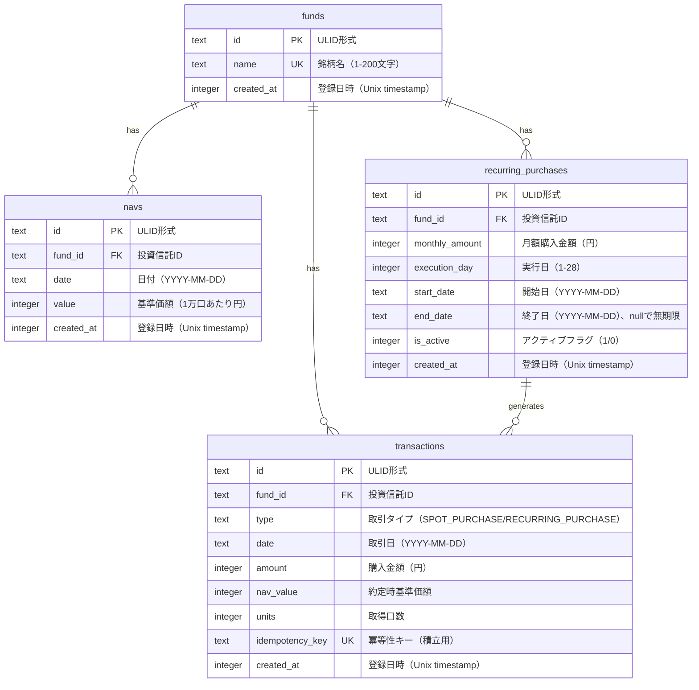

# ER図

## 概要

Trustfolioのデータベース構造を表すER図。

## ER図

## テーブル詳細

### funds（投資信託）

投資信託の基本情報を管理する。

| カラム | 型 | 制約 | 説明 |
|--------|-----|------|------|
| id | TEXT | PK | ULID形式の一意識別子 |
| name | TEXT | UNIQUE, NOT NULL | 銘柄名（1-200文字） |
| created_at | INTEGER | NOT NULL | 登録日時（Unix timestamp） |

### navs（基準価額）

投資信託の日次基準価額を管理する。

| カラム | 型 | 制約 | 説明 |
|--------|-----|------|------|
| id | TEXT | PK | ULID形式の一意識別子 |
| fund_id | TEXT | FK→funds.id | 投資信託ID |
| date | TEXT | NOT NULL | 日付（YYYY-MM-DD形式） |
| value | INTEGER | NOT NULL | 基準価額（1万口あたり円、1以上） |
| created_at | INTEGER | NOT NULL | 登録日時（Unix timestamp） |
| UNIQUE(fund_id, date) | | | 同一銘柄・日付は1件のみ |

### transactions（取引）

購入取引の履歴を管理する。

| カラム | 型 | 制約 | 説明 |
|--------|-----|------|------|
| id | TEXT | PK | ULID形式の一意識別子 |
| fund_id | TEXT | FK→funds.id | 投資信託ID |
| type | TEXT | NOT NULL | 取引タイプ（SPOT_PURCHASE/RECURRING_PURCHASE） |
| date | TEXT | NOT NULL | 取引日（YYYY-MM-DD形式） |
| amount | INTEGER | NOT NULL | 購入金額（円、1以上） |
| nav_value | INTEGER | NOT NULL | 約定時基準価額 |
| units | INTEGER | NOT NULL | 取得口数（1以上） |
| idempotency_key | TEXT | UNIQUE | 冪等性キー（積立取引の重複防止用） |
| created_at | INTEGER | NOT NULL | 登録日時（Unix timestamp） |

### recurring_purchases（積立設定）

定期購入の設定を管理する。

| カラム | 型 | 制約 | 説明 |
|--------|-----|------|------|
| id | TEXT | PK | ULID形式の一意識別子 |
| fund_id | TEXT | FK→funds.id | 投資信託ID |
| monthly_amount | INTEGER | NOT NULL | 月額購入金額（円、1以上） |
| execution_day | INTEGER | NOT NULL | 実行日（1-28） |
| start_date | TEXT | NOT NULL | 開始日（YYYY-MM-DD形式） |
| end_date | TEXT | NULL | 終了日（YYYY-MM-DD形式、nullで無期限） |
| is_active | INTEGER | NOT NULL | アクティブフラグ（1=有効、0=無効） |
| created_at | INTEGER | NOT NULL | 登録日時（Unix timestamp） |

## リレーション

1. **funds → navs**: 1対多。1つの投資信託は複数の基準価額を持つ。
2. **funds → transactions**: 1対多。1つの投資信託は複数の取引を持つ。
3. **funds → recurring_purchases**: 1対多。1つの投資信託は複数の積立設定を持つ。
4. **recurring_purchases → transactions**: 1対多。積立設定から複数の取引が生成される（idempotency_keyで紐づけ）。
