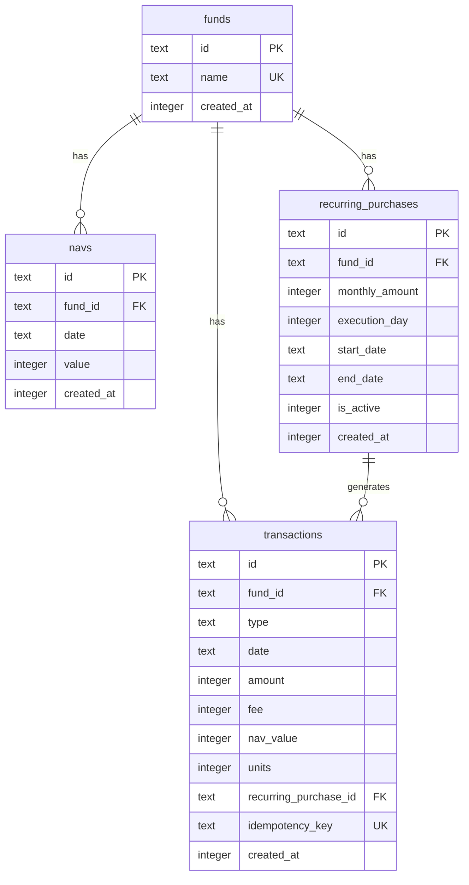

# Phase 6: 品質向上

## 概要

テストカバレッジの向上、ドキュメント整備、API仕様書作成を行う。

## 実装項目

### 1. テストカバレッジ向上

#### 1.1 カバレッジ目標

| レイヤー | 目標カバレッジ | 優先度 |
|---------|---------------|--------|
| Domain | 90%以上 | 高 |
| UseCase | 80%以上 | 高 |
| Infrastructure | 70%以上 | 中 |
| Presentation | 60%以上 | 低 |

#### 1.2 追加テストケース

**Domain層:**
- 境界値テスト（最小値、最大値）
- 異常系の網羅
- 値オブジェクトの等価性テスト

**UseCase層:**
- エッジケース（空リスト、大量データ）
- 同時実行シナリオ
- トランザクション失敗時のロールバック

**E2Eテスト:**
- 積立設定 → 1年間実行 → ポートフォリオ確認
- 複数銘柄の同時運用シナリオ

#### 1.3 カバレッジ確認

```bash
pnpm test:coverage
```

### 2. ER図作成

#### 2.1 Mermaid ER図



#### 2.2 ER図ファイル

`docs/er-diagram.md` として保存。

### 3. API仕様書

#### 3.1 OpenAPI (Swagger) 形式

`docs/api-spec.yaml` として作成。

**エンドポイント一覧:**

| メソッド | パス | 説明 |
|---------|------|------|
| GET | /health | ヘルスチェック |
| POST | /api/funds | 投資信託登録 |
| GET | /api/funds | 投資信託一覧 |
| POST | /api/funds/:fundId/navs | 基準価額登録 |
| GET | /api/funds/:fundId/navs | 基準価額履歴 |
| POST | /api/funds/:fundId/transactions | スポット購入 |
| GET | /api/funds/:fundId/transactions | 取引履歴 |
| GET | /api/funds/:fundId/holding | 保有情報 |
| POST | /api/recurring | 積立設定登録 |
| GET | /api/recurring | 積立設定一覧 |
| POST | /api/recurring/execute | 積立一括実行 |
| GET | /api/portfolio | ポートフォリオ |

#### 3.2 レスポンス例

**POST /api/funds**
```yaml
requestBody:
  required: true
  content:
    application/json:
      schema:
        type: object
        required:
          - name
        properties:
          name:
            type: string
            maxLength: 200
            example: "eMAXIS Slim 全世界株式（オール・カントリー）"

responses:
  201:
    description: 登録成功
    content:
      application/json:
        schema:
          $ref: "#/components/schemas/Fund"
  400:
    description: バリデーションエラー
    content:
      application/json:
        schema:
          $ref: "#/components/schemas/Error"
  409:
    description: 重複エラー
    content:
      application/json:
        schema:
          $ref: "#/components/schemas/Error"
```

### 4. README更新

#### 4.1 追加セクション

- **アーキテクチャ図**: レイヤー構成の図解
- **環境構築手順**: 詳細なセットアップガイド
- **開発ガイド**: コーディング規約、テスト方針
- **デプロイ手順**: 本番環境へのデプロイ方法

#### 4.2 バッジ追加

```markdown


```

### 5. CI/CD設定（オプション）

#### 5.1 GitHub Actions

`.github/workflows/ci.yml`:

```yaml
name: CI

on:
  push:
    branches: [main]
  pull_request:
    branches: [main]

jobs:
  test:
    runs-on: ubuntu-latest
    steps:
      - uses: actions/checkout@v4
      - uses: pnpm/action-setup@v2
        with:
          version: 10
      - uses: actions/setup-node@v4
        with:
          node-version: 20
          cache: pnpm
      - run: pnpm install
      - run: pnpm lint
      - run: pnpm typecheck
      - run: pnpm test:run
      - run: pnpm test:coverage
      - uses: codecov/codecov-action@v4
        with:
          files: ./coverage/lcov.info
```

### 6. コード品質チェック

#### 6.1 追加設定

**Prettier設定（オプション）:**
```json
{
  "semi": true,
  "singleQuote": false,
  "tabWidth": 2,
  "trailingComma": "es5"
}
```

**TypeScript strict設定確認:**
```json
{
  "compilerOptions": {
    "strict": true,
    "noUncheckedIndexedAccess": true,
    "exactOptionalPropertyTypes": true
  }
}
```

### 7. ドキュメント一覧

| ファイル | 内容 |
|---------|------|
| `README.md` | プロジェクト概要、セットアップ |
| `docs/request.md` | 要件定義 |
| `docs/phase1-foundation.md` | Phase 1実装詳細 |
| `docs/phase2-fund-nav.md` | Phase 2実装詳細 |
| `docs/phase3-transaction.md` | Phase 3実装詳細 |
| `docs/phase4-portfolio.md` | Phase 4実装詳細 |
| `docs/phase5-frontend.md` | Phase 5実装詳細 |
| `docs/phase6-quality.md` | Phase 6実装詳細 |
| `docs/er-diagram.md` | ER図 |
| `docs/api-spec.yaml` | OpenAPI仕様書 |

## 完了条件

- [ ] テストカバレッジがDomain層90%以上
- [ ] ER図が作成されている
- [ ] API仕様書が作成されている
- [ ] READMEが充実している
- [ ] `pnpm lint` がエラーなく通る
- [ ] `pnpm test:run` で全テスト合格
